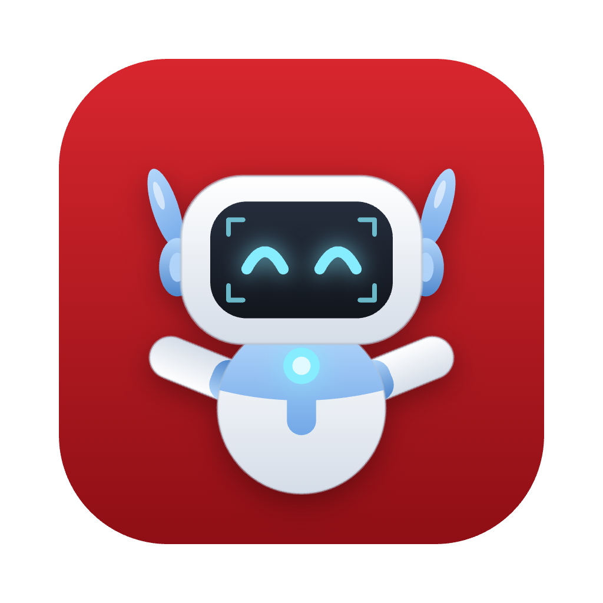

<p align="center"></p>

# MoM

A little robot that lives in the corner of your screen and holds your to-do list. Free, for macOS and Windows.

MoM floats in the corner, its eyes follow your mouse, and while you work it gets up to its own thing: soldering a PCB, fixing itself with a wrench, reading an MTE textbook, doing chemistry, or watching a Rocket League car freestyle across your screen. Check off a task and it cheers. Finish everything and a disco ball drops from the top of the screen while MoM does a robot dance.

## Download

Go to **[Releases](https://github.com/subhansajadi/mom-todo/releases/latest)** and download:

| Your computer | File |
|---|---|
| Mac (Apple Silicon or Intel) | `MoM-x.y.z-mac.dmg` |
| Windows 10 / 11 | `MoM-Setup-x.y.z.exe` |

### Installing on a Mac

1. Open the `.dmg` and drag **MoM** into **Applications**.
2. Open MoM. The first time, macOS will say it can't verify the developer, because MoM isn't paid-for signed by Apple. Click **Done**.
3. Open **System Settings → Privacy & Security**, scroll down, and click **Open Anyway** next to MoM. Confirm once more.

If macOS instead says MoM "is damaged", run this once in Terminal, then open it again:

```bash
xattr -dr com.apple.quarantine /Applications/MoM.app
```

MoM has no Dock icon. MoM itself is the app: look in the bottom-right corner of your screen.

### Installing on Windows

1. Run `MoM-Setup-x.y.z.exe`. It installs just for you, no admin needed.
2. If Windows SmartScreen says "Windows protected your PC", click **More info → Run anyway**. (This appears because MoM isn't code-signed.)

MoM appears in the bottom-right corner above the taskbar, with an icon in the system tray.

## Using MoM

- **Click MoM** to open your list. Type a task and press Enter.
- **Click a task** to check it off. Hover a task to show its ✕, or right-click it to edit.
- **Ctrl + Alt + T** (Control-Option-T on a Mac) opens the list from anywhere. **Esc** closes it.
- **Drag MoM** anywhere. It remembers where you left it.
- **Right-click MoM** for: Throw a Party, Sounds, Open at Login, Move Back to Corner, Quit.
- **Hover over MoM** to see how many things are left. It sleeps when the list is empty.

Your tasks stay on your computer, in `tasks.json`:

- macOS: `~/Library/Application Support/MoM/`
- Windows: `%APPDATA%\MoM\`

## Building it yourself

You need [Node.js](https://nodejs.org) 20 or newer.

```bash
npm install
npm start            # run it
npm run dist:mac     # build the .dmg (on a Mac)
npm run dist:win     # build the installer (on Windows)
npm run icon         # redraw the app icon from MoM's drawing code
```

Launch with `npm start -- --activity rocketLeague` to pin one activity (`soldering`, `fixing`, `rocketLeague`, `reading`, `chemistry`) while you work on it.

### Releasing

Pushing a version tag builds both versions on GitHub Actions and attaches them to a new release:

```bash
npm version patch
git push --follow-tags
```

## How it's built

Electron, with everything drawn on canvas in code (no image assets except the icon, which is also generated from the drawing code).

| File | What it does |
|---|---|
| `src/main.js` | The windows (MoM, the list, the Rocket League strip, the party overlay), dragging, the right-click menu, the shortcut |
| `src/store.js` | Tasks and settings, saved as JSON |
| `src/renderer/mascot.js` | MoM's moods, speech bubbles, activities and celebrations |
| `src/renderer/panel.*` | The to-do list |
| `src/renderer/lib/robot-art.js` | MoM drawn with vector shapes: poses, screen faces and props |
| `src/renderer/lib/robot-motion.js` | What MoM does in each mood and activity |
| `src/renderer/lib/lap.js` | The choreographed Rocket League freestyle lap |
| `src/renderer/lib/arena-art.js` | The car and ball |
| `src/renderer/overlay.js` | Confetti and the disco ball |

## License

MIT
