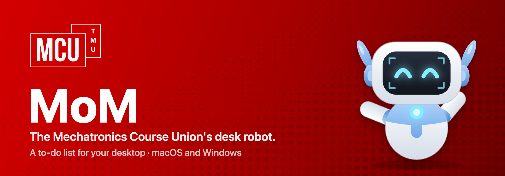
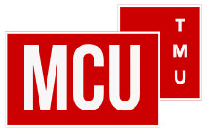

<p align="center"></p>

# MoM

**MoM is the robot of the [Mechatronics Course Union](#about-mcu) (MCU) at Toronto Metropolitan University.** It lives in the corner of your screen and holds your to-do list. It's free, for macOS and Windows, and made by MCU for tron students (and anyone else who wants a robot keeping them on track).

MoM floats in the corner, its eyes follow your mouse, and while you work it gets up to its own thing: soldering a PCB, fixing itself with a wrench, reading an MTE textbook, doing chemistry, or watching a Rocket League car freestyle across your screen. Check off a task and it cheers. Finish everything and a disco ball drops from the top of the screen while MoM does a robot dance.

## Download

Go to **[Releases](https://github.com/subhansajadi/mom-todo/releases/latest)** and download:

| Your computer | File |
|---|---|
| Mac with Apple silicon (M1, M2, M3, M4…) | `MoM-x.y.z-mac-arm64.dmg` |
| Mac with an Intel processor | `MoM-x.y.z-mac-x64.dmg` |
| Windows 10 / 11 | `MoM-Setup-x.y.z.exe` |

Not sure which Mac you have? Open the Apple menu → **About This Mac**. If it says **Chip: Apple M…**, get `arm64`. If it says **Processor: Intel**, get `x64`.

### Installing on a Mac

1. Open the `.dmg` and drag **MoM** into **Applications**.
2. Open MoM. The first time, macOS will say it can't verify the developer, because MoM isn't paid-for signed by Apple. Click **Done**.
3. Open **System Settings → Privacy & Security**, scroll down, and click **Open Anyway** next to MoM. Confirm once more.

If macOS instead says MoM "is damaged", run this once in Terminal, then open it again:

```bash
xattr -dr com.apple.quarantine /Applications/MoM.app
```

MoM has no Dock icon. MoM itself is the app: look in the bottom-right corner of your screen.

### Installing on Windows

1. Run `MoM-Setup-x.y.z.exe`. It installs just for you, no admin needed.
2. If Windows SmartScreen says "Windows protected your PC", click **More info → Run anyway**. (This appears because MoM isn't code-signed.)

MoM appears in the bottom-right corner above the taskbar, with an icon in the system tray.

## Using MoM

- **Click MoM** to open your list. Type a task and press Enter.
- **Click a task** to check it off. Hover a task to show its ✕, or right-click it to edit.
- **Ctrl + Alt + T** (Control-Option-T on a Mac) opens the list from anywhere. **Esc** closes it.
- **Drag MoM** anywhere. It remembers where you left it.
- **Right-click MoM** for: Throw a Party, Check for Updates, About, Sounds, Open at Login, Move Back to Corner, Hide MoM, Quit.
- **Need MoM out of the way** (a presentation, a screen share, an exam)? Right-click → **Hide MoM** → for 1, 2, 4 or 8 hours. It comes back by itself. To bring it back sooner, press Ctrl + Alt + T, open MoM again, or click its tray icon on Windows.
- **Hover over MoM** to see how many things are left. It sleeps when the list is empty.
- **Deleted something by mistake?** Click **Undo**, or press ⌘Z (Ctrl+Z on Windows) with the list open.

### Updates

When there's a new version, MoM tells you and shows what's new at the top of your list. Click **Update now**:

- **Mac:** MoM downloads the update, checks it, replaces itself and reopens. (If MoM isn't in your Applications folder, it gives you a **Download** button instead. Download the new `.dmg` and drag MoM into Applications.)
- **Windows:** MoM downloads the update in the background. Click **Restart to update**, or it installs next time you quit MoM.

Click **Later** to hide it for a day. Your tasks are never touched by an update.

### Your data

Your tasks stay on your computer, in `tasks.json`. MoM also keeps `tasks.backup.json`, a copy of the list from the last time it started:

- macOS: `~/Library/Application Support/MoM/`
- Windows: `%APPDATA%\MoM\`

MoM doesn't collect anything. The only thing it sends over the internet is a check with GitHub for a newer version, a few times a day. If something goes wrong, `logs/main.log` in that folder helps when you report a bug.

## Building it yourself

You need [Node.js](https://nodejs.org) 20 or newer.

```bash
npm install
npm start            # run it
npm run dist:mac     # build the .dmg (on a Mac)
npm run dist:win     # build the installer (on Windows)
npm run art          # redraw the icon, README banner and installer background
```

Launch with `npm start -- --activity rocketLeague` to pin one activity (`soldering`, `fixing`, `rocketLeague`, `reading`, `chemistry`) while you work on it.

### Releasing an update

Everyone who has MoM installed finds out about a new version on their own, within about 6 hours (or at their next login). To ship one:

1. Write what's new in [`build/release-notes.md`](build/release-notes.md), one bullet per feature, written for students. MoM shows the first five bullets in its update card, so put the best ones first.
2. Bump the version and push the tag. GitHub Actions builds both versions and publishes the release:

```bash
npm version minor
```

```bash
git push --follow-tags
```

The release must include `latest-mac.yml`, `latest.yml`, the Mac `.zip` files and the `.blockmap` files. The workflow uploads them. Without them, installed copies never see the update. The repo has to be public (`subhansajadi/mom-todo`), because MoM reads releases without signing in.

To test an update on your own machine before releasing, build two versions and serve the newer one's `latest-mac.yml` and `.zip` from a local folder. Then start the older one with `MOM_UPDATE_FEED=http://127.0.0.1:8765` and `MOM_DATA_DIR=/tmp/mom-test`, so it doesn't touch your real list.

## How it's built

Electron, with MoM and everything around it drawn on canvas in code. The icon, README banner and macOS installer background are generated from the same drawing code plus the MCU logo (`scripts/make-art.js`).

| File | What it does |
|---|---|
| `src/main.js` | The windows (MoM, the list, the Rocket League strip, the party overlay), dragging, the right-click menu, the shortcut |
| `src/store.js` | Tasks and settings, saved as JSON, with a backup and undo |
| `src/updates.js` | Checks GitHub for new versions, shows what's new, installs updates |
| `src/log.js` | The log file in MoM's data folder |
| `src/renderer/mascot.js` | MoM's moods, speech bubbles, activities and celebrations |
| `src/renderer/panel.*` | The to-do list |
| `src/renderer/lib/robot-art.js` | MoM drawn with vector shapes: poses, screen faces and props |
| `src/renderer/lib/robot-motion.js` | What MoM does in each mood and activity |
| `src/renderer/lib/lap.js` | The choreographed Rocket League freestyle lap |
| `src/renderer/lib/arena-art.js` | The car and ball |
| `src/renderer/overlay.js` | Confetti and the disco ball |

## About MCU



The **Mechatronics Course Union** is the student course union for Mechatronics Engineering at Toronto Metropolitan University (TMU). MCU runs events and supports MTE students through the program, and MoM is its mascot. MoM the app is one of the ways MCU tries to make the grind a bit more fun.

MTE student with an idea for MoM (a new activity, a new party, a bug)? Open an issue or a pull request.

## License

MIT. The MCU name and logo belong to the Mechatronics Course Union. Please don't reuse them outside of MoM without asking MCU.
